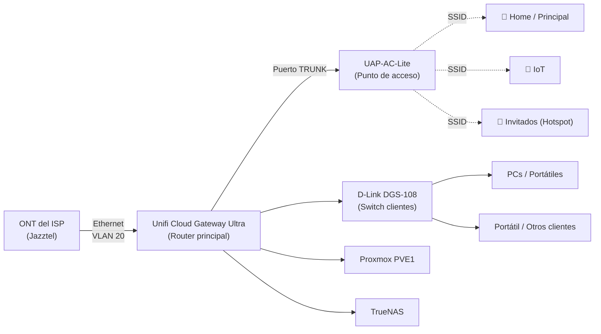
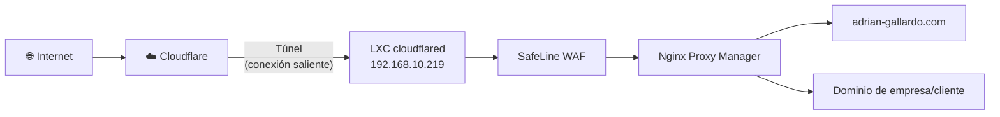
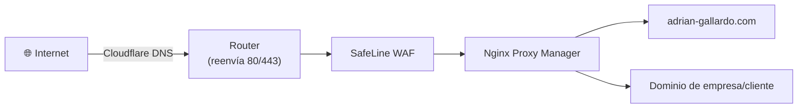

# 🏠 Mi Homelab

Documentación de mi laboratorio doméstico: red, virtualización, servicios auto-alojados y configuración de dominios/correo.

> **Novedad:** las webs ya no se publican abriendo los puertos 80/443 del router, sino mediante un **Cloudflare Tunnel**. Lo que ha quedado obsoleto no se ha borrado: está marcado como **ANTIGUO** (en desplegables) para conservar el histórico.

## 📖 Índice

- [Arquitectura de red](#-arquitectura-de-red)
  - [Hardware](#hardware)
  - [Conexión a Internet](#conexión-a-internet)
  - [El truco de Jazztel: VLAN en vez de PPPoE](#el-truco-de-jazztel-vlan-en-vez-de-pppoe)
  - [Configuración de puertos del router](#configuración-de-puertos-del-router)
  - [Switch de clientes](#switch-de-clientes)
  - [DHCP](#dhcp)
  - [WiFi](#wifi)
  - [Seguridad de red (IDS/IPS)](#seguridad-de-red-idsips)
  - [DNS dinámico](#dns-dinámico)
  - [Cloudflare Tunnel](#cloudflare-tunnel)
- [Servidores](#-servidores)
  - [Proxmox — PVE1](#proxmox--pve1)
  - [TrueNAS](#truenas)
- [Servicios](#-servicios)
- [Copias de seguridad](#-copias-de-seguridad)
- [Dominios, correo y SSL](#-dominios-correo-y-ssl)
- [Mejoras a corto plazo](#-mejoras-a-corto-plazo)

---

## 🖧 Arquitectura de red



**Flujo de tráfico web entrante (actual, con Cloudflare Tunnel):**



<details>
<summary>🕰️ <b>ANTIGUO</b> — Flujo de tráfico web entrante con los puertos 80/443 abiertos</summary>



</details>

### Hardware

| Función | Equipo |
|---|---|
| Router | Unifi Cloud Gateway Ultra |
| Switch de clientes (no gestionable) | D-Link DGS-108 |
| Punto de acceso WiFi | UAP-AC-Lite |

### Conexión a Internet

La fibra llega a la **ONT** del operador. De ahí sale un cable Ethernet directo a **mi router** (el router del ISP se ha retirado por completo).

El **Unifi Cloud Gateway Ultra** hace de router principal para salir a Internet.

> **Curiosidad:** mi ISP (Jazztel) no me da servicio mediante un usuario/contraseña PPPoE como es habitual, sino a través de la **VLAN 20** sin autenticación. Esto no me lo indicó el ISP, tuve que investigarlo por mi cuenta.

### El truco de Jazztel: VLAN en vez de PPPoE

Después de investigar, esto tiene una explicación técnica: la fibra de Jazztel es en muchas zonas **fibra indirecta sobre la red NEBA de Telefónica** (no red propia de Orange/Jazztel), y ese tipo de acceso mayorista no usa autenticación PPPoE, sino **IPoE con DHCP sobre una VLAN concreta (la VLAN 20)**. Por eso basta con levantar una interfaz con VLAN ID 20 y pedir IP por DHCP para tener conexión, sin usuario ni contraseña. Si el ISP proporciona la fibra de forma directa (ONT integrada en el router del ISP) suele usarse otra VLAN distinta (1074), pero en instalaciones con ONT y router separados como la mía, la 20 es la que funciona.

### Configuración de puertos del router

**Vista general de los puertos del Cloud Gateway Ultra:**


| Puerto | Destino | Modo |
|---|---|---|
| Puerto 1 | UAP-AC-Lite (AP) | **Trunk** — pasan todas las VLAN para poder tener un SSID por red |
| Puerto 2 | Proxmox PVE1 | Native VLAN Servers_Network (10), tagged Clients_Network (20) |
| Puerto 3 | TrueNAS | Native VLAN Servers_Network (10), tagged Clients_Network (20) |
| Puerto 4 | Switch de clientes | Native VLAN Clients_Network (20), tagged Servers_Network (10) e IoT_Network (60) |
| Puerto 5 (2.5 GbE) | WAN / Internet | VLAN 20 manual (ver apartado ISP) |

**Puerto 1 — AP (modo Trunk):**


**Puerto 2 — Proxmox PVE1:**


**Puerto 3 — TrueNAS:**


**Puerto 4 — Switch de clientes:**


**Puerto 5 (WAN) — Internet, VLAN 20 manual:**


**Configuración IPv4/DNS del WAN:**


> **Nota:** con el Cloudflare Tunnel ya **no hay port forwarding de 80/443** hacia SafeLine en el router (ver [Cloudflare Tunnel](#cloudflare-tunnel)).

### Switch de clientes

El **D-Link DGS-108** es un switch **no gestionable**, sencillo, usado únicamente para conectar clientes finales (PCs, portátiles, etc.) a la VLAN de clientes.

### DHCP

No hay un servidor DHCP dedicado: el propio **router (Unifi Cloud Gateway Ultra)** reparte las IPs en todas las redes/VLAN.

### WiFi

Actualmente hay **3 SSID**:


| SSID | Uso | Bandas |
|---|---|---|
| Red Principal | Miembros de la casa: móviles, portátiles, tablets | Solo 5 GHz |
| IoT | Dispositivos IoT: TV, Chromecast, aspirador inteligente, etc. | 2.4 GHz y 5 GHz |
| Invitados | Acceso a Internet mediante un Hotspot simple con autenticación previa | Solo 5 GHz |

> **Nota:** en la red IoT está activada la opción **Enhanced IoT Connectivity**, para maximizar la compatibilidad con dispositivos que no cumplen bien los estándares WiFi modernos.

### Seguridad de red (IDS/IPS)

El sistema de **detección y prevención de intrusos** está activo: en cuanto detecta una petición de riesgo hacia la red, la bloquea al instante.


### DNS dinámico

Para las **webs** ya no es necesario: el dominio apunta al túnel de Cloudflare, no a mi IP pública, así que el registro `A` que actualizaba el DDNS se ha eliminado y el DDNS se ha desactivado para esos dominios (si no, volvería a crear el registro `A` y la ruta del túnel daría error).

El DDNS solo sigue siendo necesario para los registros que **sí** necesitan mi IP pública, como los del **correo** de HestiaCP (IMAP/SMTP siguen abiertos en el router).

<details>
<summary>🕰️ <b>ANTIGUO</b> — DDNS con Cloudflare para las webs</summary>

Configurado **DDNS con Cloudflare** para mantener actualizados los registros DNS del dominio con la IP pública, que puede cambiar.


</details>

### Cloudflare Tunnel

#### Qué es y para qué sirve

**En una frase:** un programa dentro de mi red (el LXC `cloudflared`) abre una conexión **hacia fuera** con Cloudflare, y por ahí le llegan las visitas de mis webs. No abro ningún puerto: es mi casa la que llama a Cloudflare, no al revés.

- **Sin túnel:** Internet → Cloudflare → mi IP pública (80/443 abiertos) → SafeLine → NPM
- **Con túnel:** Internet → Cloudflare → túnel → LXC cloudflared → SafeLine → NPM

#### Ventajas

- **Cero puertos abiertos en el router** para el tráfico web. Los bots que escanean IPs al azar (los miles de bloqueos que veía en UniFi) no encuentran nada.
- **Mi IP deja de estar en el DNS.** El dominio apunta al túnel, no a mi IP. Aunque alguien la tenga guardada de antes, no hay nada a lo que conectarse.
- **No se puede saltar Cloudflare.** Antes, quien conocía mi IP atacaba directamente 80/443. Ahora todo el tráfico web tiene que pasar por Cloudflare y luego por SafeLine.
- **Gratis** en el plan Free.
- **Funciona aunque cambie mi IP pública**, así que el DDNS ya no hace falta para las webs.
- **Un solo túnel vale para varios dominios**: solo hay que añadir rutas.
- **Si cambio de ISP o de router**, el túnel sigue funcionando sin tocar nada: solo necesita salida a Internet.

#### Limitaciones

- **No protege de un DDoS que ataque mi IP directamente** (satura la línea antes del router). Por eso importa que mi IP no se filtre.
- **Dependo de Cloudflare:** si cae Cloudflare o el LXC, mis webs caen.
- **Bloqueos de LaLiga:** afectan a las IPs de Cloudflare en España, con túnel o sin él.
- **Solo cubre tráfico web** (HTTP/HTTPS en este uso). Otros servicios, como una VPN, necesitan otro método (por ejemplo Teleport).
- **Renovar certificados Let's Encrypt de HestiaCP** por el puerto 80 puede fallar al no tener los puertos abiertos; habría que usar validación por DNS (ver [Mejoras a corto plazo](#-mejoras-a-corto-plazo)).

#### 1. Crear el LXC en Proxmox

1. En la shell de PVE1, pegar el comando del script **Cloudflared** de Proxmox VE Helper Scripts (community-scripts) y elegir **Default**.
2. Resultado: LXC `cloudflared`, Debian 13, IP `192.168.10.219`, en Servers_Network (VLAN 10), la misma red que SafeLine.

<!-- Pasted image 20261017153331.png -->


#### 2. Crear el túnel en Cloudflare

1. Cloudflare → **Networking > Tunnels > Create Tunnel**.

   <!-- Pasted image 20261017153412.png -->
   

2. Tipo **Cloudflared**, nombre `Home`.

   <!-- Pasted image 20261017153607.png -->
   

   <!-- Pasted image 20261017153639.png -->
   

3. Elegir **Debian** y **64-bit**.

   <!-- Pasted image 20261017153747.png -->
   

#### 3. Conectar el LXC al túnel

1. En la consola del LXC, pegar el comando de **"Install as service"** que da Cloudflare, **sin el `sudo`**:

   ```bash
   cloudflared service install TU_TOKEN
   ```

   Si no lo permite, leer el error que muestra.

2. Debe salir "Linux service for cloudflared installed successfully".

   <!-- Pasted image 20261017153931.png -->
   

3. En Cloudflare, el estado del túnel pasa a **Healthy**.

   <!-- Pasted image 20261017154039.png -->
   

#### 4. Comprobar que no existe el registro A

Simplemente nos aseguramos antes de crear la ruta:

1. Cloudflare → **Domains > adrian-gallardo.com > DNS > Records**.
2. Borrar el **A** `adrian-gallardo.com` → IP pública. Si no, la ruta da el error "A, AAAA or CNAME record already exists".

#### 5. Crear la ruta

<!-- Pasted image 20261017154101.png -->


1. Túnel `Home` → **Routes > Add route > Published application**.

   <!-- Pasted image 20261017154118.png -->
   

2. Rellenar:
   - **Subdomain:** vacío
   - **Domain:** `adrian-gallardo.com`
   - **Service URL:** la IP de SafeLine, `http://192.168.10.179`. En mi caso apunta a SafeLine porque después SafeLine le pasa el tráfico a NPM, pero podría ser directamente la IP de cualquier servicio.

   <!-- Pasted image 20261017154140.png -->
   

   <!-- Pasted image 20261017154310.png -->
   

En este caso el dominio es `adrian-gallardo.com`, pero también podría ser un subdominio.

<!-- Pasted image 20261017154405.png -->


> ⚠️ **Muy importante — vigilar el Service URL.** Si Cloudflare muestra el típico error *Host down*, probar a cambiar `https` por `http`. En mi caso funciona con **HTTP**, aunque en alguna captura aparezca `https`.

Al guardar, Cloudflare crea automáticamente el registro **CNAME**:

<!-- Pasted image 20261017154450.png -->


<!-- Pasted image 20261017154538.png -->


#### 6. Comprobar

Probar desde el móvil con datos. Si en casa no carga, mirar `hayahora.futbol`: el bloqueo de LaLiga afecta a las IPs `188.114.96.5` y `188.114.97.5`. En ese caso, usar una VPN.

#### 7. Pendiente al final

1. Borrar el **Port Forwarding de 80 y 443** en UniFi. Con esto ya no hay puertos abiertos para el tráfico web.
2. Desactivar el **DDNS de UniFi** para ese dominio, porque recrearía el registro A.

#### Si borro el túnel y lo creo de cero

**En el contenedor no hay que reinstalar nada.** Solo cambia el token:

1. En el LXC: `cloudflared service uninstall`
2. Crear el túnel nuevo en Cloudflare y copiar su token (el viejo deja de valer).
3. En el LXC: `cloudflared service install NUEVO_TOKEN`

---

## 🖥️ Servidores

### Proxmox — PVE1

| Componente | Especificación |
|---|---|
| Equipo | Mini PC Teclast N10 |
| RAM | 6 GB SODIMM DDR4 |
| CPU | Celeron N4000 (2 núcleos / 2 hilos, 2.6 GHz) |
| Almacenamiento | SSD externo Kingston 240 GB (SATA) |

Es el **servidor más importante** del homelab: corre 7 contenedores LXC (incluido `cloudflared`) y 1 VM. Aunque los recursos son limitados, son más que suficientes para todos los servicios que aloja.

<details>
<summary>🕰️ <b>ANTIGUO</b> — Antes de añadir cloudflared</summary>

Es el **servidor más importante** del homelab: corre 6 contenedores LXC y 1 VM. Aunque los recursos son limitados, son más que suficientes para todos los servicios que aloja.

</details>

### TrueNAS

| Componente | Especificación |
|---|---|
| Equipo | Mini PC Lenovo |
| CPU | i3 7100T |
| RAM | 8 GB DDR4 2133 MHz |
| Discos | 1 HDD 160 GB (S.O.) + 2 HDD 1 TB (RAID 1 / espejo para datos) |

> **Sobre el clúster:** antes tenía ambos nodos de Proxmox en clúster. Decidí separarlos porque, con equipos tan limitados, un clúster añade complejidad innecesaria si no vas a tener los nodos activos 24/7. **Sigo recomendando el clúster al 100%** si tus servidores van a estar siempre encendidos; en mi caso, aunque ahora sí lo están, prefiero mantenerlos independientes por simplicidad.

---

## ⚙️ Servicios

Todos corren sobre **PVE1** salvo que se indique lo contrario.

### AdGuard Home
Bloqueador de anuncios/trackers a nivel de red, con **DNS cifrado (DoT y DoH)**.


### Homarr
Dashboard central para acceder a todos los servicios del homelab.


### Cloudflared (Cloudflare Tunnel)
LXC Debian 13 (`192.168.10.219`, Servers_Network VLAN 10) que mantiene el túnel con Cloudflare. Es la **puerta de entrada** de todo el tráfico web: recibe las visitas desde Cloudflare y las entrega a SafeLine. Guía completa en [Cloudflare Tunnel](#cloudflare-tunnel).

### SafeLine (WAF)
Web Application Firewall para proteger los dominios publicados. Es la **primera parada tras el túnel de Cloudflare** para todo el tráfico web que entra desde Internet, antes de llegar a ningún servicio.


**Dominios expuestos actualmente a través de SafeLine:**

- `adrian-gallardo.com`
- Un dominio adicional de una empresa/cliente

### Nginx Proxy Manager (NPM)
Proxy inverso interno. Flujo completo del tráfico entrante:

1. **Cloudflare** recibe la petición del dominio (el DNS apunta al túnel, no a mi IP pública).
2. El **túnel** la entrega al LXC `cloudflared`, que la reenvía a la IP de **SafeLine**. No hay puertos 80/443 abiertos en el router.
3. **SafeLine** filtra el tráfico (WAF) y lo reenvía a **NPM**.
4. **NPM** redirige el tráfico a cada servicio local correspondiente según el dominio/subdominio solicitado.

<details>
<summary>🕰️ <b>ANTIGUO</b> — Flujo con los puertos 80/443 abiertos</summary>

1. **Cloudflare** apunta cada dominio a mi IP pública.
2. El router (Unifi Cloud Gateway Ultra) reenvía los puertos **80** y **443** a la IP de **SafeLine**.
3. **SafeLine** filtra el tráfico (WAF) y lo reenvía a **NPM**.
4. **NPM** redirige el tráfico a cada servicio local correspondiente según el dominio/subdominio solicitado.

</details>

### Vaultwarden
Gestor de contraseñas autoalojado (compatible con Bitwarden).


### Uptime Kuma
Monitorización de servicios, integrado con **ntfy** para recibir alertas en el móvil. Muchas caídas, por bloqueos de mi amigo Tebas.


### HestiaCP
Uno de los servicios más importantes del homelab: aloja el **servidor de correo electrónico** y páginas web de algún cliente.


### Immich
Alternativa autoalojada a Google Fotos. Implementado recientemente aprovechando el espacio libre del RAID de TrueNAS.

**Proceso de instalación y montaje del almacenamiento:**

1. Crear un **dataset NFS** en TrueNAS.
2. Conectar ese NFS a Proxmox.
3. Crear el LXC de Immich usando **Proxmox Helper Scripts**.
4. Desde la shell de Proxmox, editar la configuración del LXC para montar el NFS dentro del contenedor.
5. Probar que, al escribir dentro del LXC, los archivos aparecen físicamente en el dataset de TrueNAS.
6. Editar la configuración indicada por Proxmox Helper Scripts para cambiar la ruta donde se guardan fotos/vídeos.
7. Crear un **enlace simbólico** hacia el nuevo destino (según las instrucciones) y borrar las rutas antiguas.
8. Instalar la app en el móvil, conectarse al servidor y empezar a subir contenido.

---

## 💾 Copias de seguridad

Política de backups, gestionada desde **TrueNAS**:

- Los **contenedores** que corren en PVE1 se respaldan en un espacio compartido por NFS en TrueNAS.
- Desde ahí, las copias se envían a **MEGA**.
- Frecuencia: **1 copia de cada contenedor a principio de mes** (apenas sufren cambios).
- También se respaldan las **carpetas compartidas más relevantes**, enviadas igualmente a MEGA.

---

## 🌐 Dominios, correo y SSL

### HestiaCP

Para publicar una web: se añade el dominio y normalmente se instala un WordPress.

Para que funcione el **webmail**, hay que añadir `webmail.dominio.com` como alias del dominio.

Para el **correo**, simplemente se añade el dominio y se activan las siguientes opciones:


- Webmail Client: Roundcube
- Spam Filter
- Reject Spam
- Anti-Virus
- DKIM Support
- Enable SSL for this domain (Let's Encrypt)

> **Para poder emitir el certificado SSL** hace falta que Let's Encrypt llegue a HestiaCP por el puerto 80. Como ahora el tráfico web entra por el Cloudflare Tunnel y no hay 80/443 abiertos, la emisión/renovación puede fallar. Mientras no se use validación por DNS, la solución es el procedimiento antiguo: abrir **temporalmente** 80/443 hacia HestiaCP y volver a cerrarlos después.

<details>
<summary>🕰️ <b>ANTIGUO</b> — Emisión del certificado con el redireccionamiento permanente de puertos</summary>

> **Para poder emitir el certificado SSL**, es necesario redirigir **temporalmente** el tráfico de los puertos 80 y 443 hacia la IP de HestiaCP, ya que si no, no se pueden emitir/renovar los certificados.

</details>

Después, para que todo resuelva correctamente, se consulta la sección **DNS Records** de HestiaCP y se van copiando esos registros en el proveedor del dominio (en mi caso, **Cloudflare**).

> **Importante con Cloudflare:** en los registros del correo (MX, host de correo, etc.) **no hay que activar la nube naranja** (proxy). Los puertos de correo (IMAP/SMTP) no pasan por el túnel, que solo cubre HTTP/HTTPS.

### Configuración SSL/TLS en Cloudflare

**Edge Certificates** — certificado universal activo para el dominio y subdominios:


**Ajustes generales de SSL/TLS:**


- Always Use HTTPS: activado
- HSTS: activado (Max-Age 3 meses)
- Minimum TLS Version: TLS 1.2
- Opportunistic Encryption: activado

**TLS 1.3 y HTTPS Rewrites:**


- TLS 1.3: activado
- Automatic HTTPS Rewrites: activado
- Certificate Transparency Monitoring: desactivado

## 🚧 Mejoras a corto plazo

- [ ] **Cerrar del todo los puertos web:** borrar el Port Forwarding de 80 y 443 en UniFi y desactivar el DDNS de los dominios que ya van por túnel (si no está hecho ya).
- [ ] **Validación por DNS para Let's Encrypt en HestiaCP**, para poder renovar certificados sin abrir el puerto 80.
- [ ] **Backup de la configuración de TrueNAS**: aunque los datos están protegidos en RAID 1, la configuración del propio sistema (usuarios, shares, datasets, tareas programadas) no tiene copia. Exportar la config periódicamente y enviarla a MEGA junto con el resto de backups.
- [ ] **Segundo Mini PC para automatización (Hermes Agent + n8n)**: montar un nuevo nodo dedicado a agentes de IA y automatización de workflows, ubicado en `Servers_Network (10)`.
  - Definir si el modelo de Hermes Agent corre en local (requiere más RAM/GPU) o contra una API externa (más ligero).
  - Si se expone algún webhook/endpoint hacia fuera, pasarlo por el mismo camino que el resto de servicios: `Cloudflare Tunnel → SafeLine → NPM`, nunca expuesto directo.
  - Guardar las credenciales de las integraciones en Vaultwarden en lugar de dejarlas en texto plano dentro de n8n.
  - Añadir el nuevo servicio a Uptime Kuma para monitorización.
- [ ] **Vigilar la carga de PVE1**: con un Celeron N4000 corriendo 7 LXC + 1 VM está bastante ajustado. Antes de añadir más contenedores, revisar consumo de CPU/RAM para no llegar al límite.
