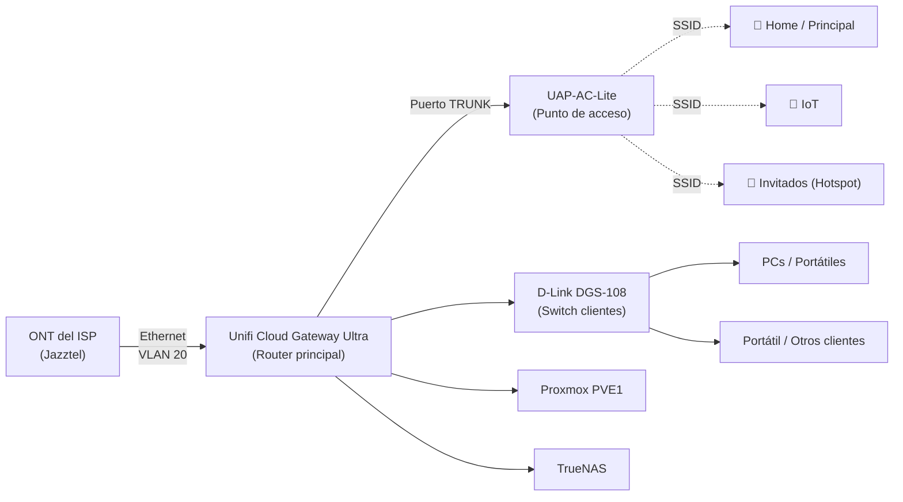

# 🏠 Mi Homelab

Documentación de mi laboratorio doméstico: red, virtualización, servicios auto-alojados y configuración de dominios/correo.

## 📖 Índice

- [Arquitectura de red](#-arquitectura-de-red)
  - [Hardware](#hardware)
  - [Conexión a Internet](#conexión-a-internet)
  - [El truco de Jazztel: VLAN en vez de PPPoE](#el-truco-de-jazztel-vlan-en-vez-de-pppoe)
  - [Configuración de puertos del router](#configuración-de-puertos-del-router)
  - [Switch de clientes](#switch-de-clientes)
  - [DHCP](#dhcp)
  - [WiFi](#wifi)
  - [Seguridad de red (IDS/IPS)](#seguridad-de-red-idsips)
  - [DNS dinámico](#dns-dinámico)
- [Servidores](#-servidores)
  - [Proxmox — PVE1](#proxmox--pve1)
  - [TrueNAS](#truenas)
- [Servicios](#-servicios)
- [Copias de seguridad](#-copias-de-seguridad)
- [Dominios, correo y SSL](#-dominios-correo-y-ssl)

---

## 🖧 Arquitectura de red

### Hardware

| Función | Equipo |
|---|---|
| Router | Unifi Cloud Gateway Ultra |
| Switch de clientes (no gestionable) | D-Link DGS-108 |
| Punto de acceso WiFi | UAP-AC-Lite |

### Conexión a Internet

La fibra llega a la **ONT** del operador. De ahí sale un cable Ethernet directo a **mi router** (el router del ISP se ha retirado por completo).

El **Unifi Cloud Gateway Ultra** hace de router principal para salir a Internet.

> **Curiosidad:** mi ISP (Jazztel) no me da servicio mediante un usuario/contraseña PPPoE como es habitual, sino a través de la **VLAN 20** sin autenticación. Esto no me lo indicó el ISP, tuve que investigarlo por mi cuenta.

### El truco de Jazztel: VLAN en vez de PPPoE

Después de investigar, esto tiene una explicación técnica: la fibra de Jazztel es en muchas zonas **fibra indirecta sobre la red NEBA de Telefónica** (no red propia de Orange/Jazztel), y ese tipo de acceso mayorista no usa autenticación PPPoE, sino **IPoE con DHCP sobre una VLAN concreta (la VLAN 20)**. Por eso basta con levantar una interfaz con VLAN ID 20 y pedir IP por DHCP para tener conexión, sin usuario ni contraseña. Si el ISP proporciona la fibra de forma directa (ONT integrada en el router del ISP) suele usarse otra VLAN distinta (1074), pero en instalaciones con ONT y router separados como la mía, la 20 es la que funciona.

### Configuración de puertos del router

**Vista general de los puertos del Cloud Gateway Ultra:**

| Puerto | Destino | Modo |
|---|---|---|
| Puerto 1 | UAP-AC-Lite (AP) | **Trunk** — pasan todas las VLAN para poder tener un SSID por red |
| Puerto 2 | Proxmox PVE1 | Native VLAN Servers_Network (10), tagged Clients_Network (20) |
| Puerto 3 | TrueNAS | Native VLAN Servers_Network (10), tagged Clients_Network (20) |
| Puerto 4 | Switch de clientes | Native VLAN Clients_Network (20), tagged Servers_Network (10) e IoT_Network (60) |
| Puerto 5 (2.5 GbE) | WAN / Internet | VLAN 20 manual (ver apartado ISP) |

**Puerto 1 — AP (modo Trunk):**

**Puerto 2 — Proxmox PVE1:**

**Puerto 3 — TrueNAS:**

**Puerto 4 — Switch de clientes:**

**Puerto 5 (WAN) — Internet, VLAN 20 manual:**

**Configuración IPv4/DNS del WAN:**

### Switch de clientes

El **D-Link DGS-108** es un switch **no gestionable**, sencillo, usado únicamente para conectar clientes finales (PCs, portátiles, etc.) a la VLAN de clientes.

### DHCP

No hay un servidor DHCP dedicado: el propio **router (Unifi Cloud Gateway Ultra)** reparte las IPs en todas las redes/VLAN.

### WiFi

Actualmente hay **3 SSID**:

| SSID | Uso | Bandas |
|---|---|---|
| Red Principal | Miembros de la casa: móviles, portátiles, tablets | Solo 5 GHz |
| IoT | Dispositivos IoT: TV, Chromecast, aspirador inteligente, etc. | 2.4 GHz y 5 GHz |
| Invitados | Acceso a Internet mediante un Hotspot simple con autenticación previa | Solo 5 GHz |

> **Nota:** en la red IoT está activada la opción **Enhanced IoT Connectivity**, para maximizar la compatibilidad con dispositivos que no cumplen bien los estándares WiFi modernos.

### Seguridad de red (IDS/IPS)

El sistema de **detección y prevención de intrusos** está activo: en cuanto detecta una petición de riesgo hacia la red, la bloquea al instante.

### DNS dinámico

Configurado **DDNS con Cloudflare** para mantener actualizados los registros DNS del dominio con la IP pública, que puede cambiar.

---

## 🖥️ Servidores

### Proxmox — PVE1

| Componente | Especificación |
|---|---|
| Equipo | Mini PC Teclast N10 |
| RAM | 6 GB SODIMM DDR4 |
| CPU | Celeron N4000 (2 núcleos / 2 hilos, 2.6 GHz) |
| Almacenamiento | SSD externo Kingston 240 GB (SATA) |

Es el **servidor más importante** del homelab: corre 6 contenedores LXC y 1 VM. Aunque los recursos son limitados, son más que suficientes para todos los servicios que aloja.

### TrueNAS

| Componente | Especificación |
|---|---|
| Equipo | Mini PC Lenovo |
| CPU | i3 7100T |
| RAM | 8 GB DDR4 2133 MHz |
| Discos | 1 HDD 160 GB (S.O.) + 2 HDD 1 TB (RAID 1 / espejo para datos) |

> **Sobre el clúster:** antes tenía ambos nodos de Proxmox en clúster. Decidí separarlos porque, con equipos tan limitados, un clúster añade complejidad innecesaria si no vas a tener los nodos activos 24/7. **Sigo recomendando el clúster al 100%** si tus servidores van a estar siempre encendidos; en mi caso, aunque ahora sí lo están, prefiero mantenerlos independientes por simplicidad.

---

## ⚙️ Servicios

Todos corren sobre **PVE1** salvo que se indique lo contrario.

### AdGuard Home
Bloqueador de anuncios/trackers a nivel de red, con **DNS cifrado (DoT y DoH)**.

### Homarr
Dashboard central para acceder a todos los servicios del homelab.

### Nginx Proxy Manager (NPM)
Proxy inverso. Flujo de tráfico entrante:

1. **Cloudflare** apunta el dominio a mi IP pública.
2. Desde el router del ISP (histórico) se redirige el tráfico al **router Unifi**.
3. El router Unifi reenvía los puertos **80** y **443** a la IP de **NPM**.
4. **NPM** redirige el tráfico a cada servicio local correspondiente.

### SafeLine (WAF)
Web Application Firewall para proteger los dominios publicados.

### Vaultwarden
Gestor de contraseñas autoalojado (compatible con Bitwarden).

### Uptime Kuma
Monitorización de servicios, integrado con **ntfy** para recibir alertas en el móvil.

### HestiaCP
Uno de los servicios más importantes del homelab: aloja el **servidor de correo electrónico** y páginas web de algún cliente.

### Immich
Alternativa autoalojada a Google Fotos. Implementado recientemente aprovechando el espacio libre del RAID de TrueNAS.

**Proceso de instalación y montaje del almacenamiento:**

1. Crear un **dataset NFS** en TrueNAS.
2. Conectar ese NFS a Proxmox.
3. Crear el LXC de Immich usando **Proxmox Helper Scripts**.
4. Desde la shell de Proxmox, editar la configuración del LXC para montar el NFS dentro del contenedor.
5. Probar que, al escribir dentro del LXC, los archivos aparecen físicamente en el dataset de TrueNAS.
6. Editar la configuración indicada por Proxmox Helper Scripts para cambiar la ruta donde se guardan fotos/vídeos.
7. Crear un **enlace simbólico** hacia el nuevo destino (según las instrucciones) y borrar las rutas antiguas.
8. Instalar la app en el móvil, conectarse al servidor y empezar a subir contenido.

---

## 💾 Copias de seguridad

Política de backups, gestionada desde **TrueNAS**:

- Los **contenedores** que corren en PVE1 se respaldan en un espacio compartido por NFS en TrueNAS.
- Desde ahí, las copias se envían a **MEGA**.
- Frecuencia: **1 copia de cada contenedor a principio de mes** (apenas sufren cambios).
- También se respaldan las **carpetas compartidas más relevantes**, enviadas igualmente a MEGA.

---

## 🌐 Dominios, correo y SSL

### HestiaCP

Para publicar una web: se añade el dominio y normalmente se instala un WordPress.

Para que funcione el **webmail**, hay que añadir `webmail.dominio.com` como alias del dominio.

Para el **correo**, simplemente se añade el dominio y se activan las siguientes opciones:

- Webmail Client: Roundcube
- Spam Filter
- Reject Spam
- Anti-Virus
- DKIM Support
- Enable SSL for this domain (Let's Encrypt)

> **Para poder emitir el certificado SSL**, es necesario redirigir **temporalmente** el tráfico de los puertos 80 y 443 hacia la IP de HestiaCP, ya que si no, no se pueden emitir/renovar los certificados.

Después, para que todo resuelva correctamente, se consulta la sección **DNS Records** de HestiaCP y se van copiando esos registros en el proveedor del dominio (en mi caso, **Cloudflare**).

### Configuración SSL/TLS en Cloudflare

**Edge Certificates** — certificado universal activo para el dominio y subdominios:

**Ajustes generales de SSL/TLS:**

- Always Use HTTPS: activado
- HSTS: activado (Max-Age 3 meses)
- Minimum TLS Version: TLS 1.2
- Opportunistic Encryption: activado

**TLS 1.3 y HTTPS Rewrites:**

- TLS 1.3: activado
- Automatic HTTPS Rewrites: activado
- Certificate Transparency Monitoring: desactivado
